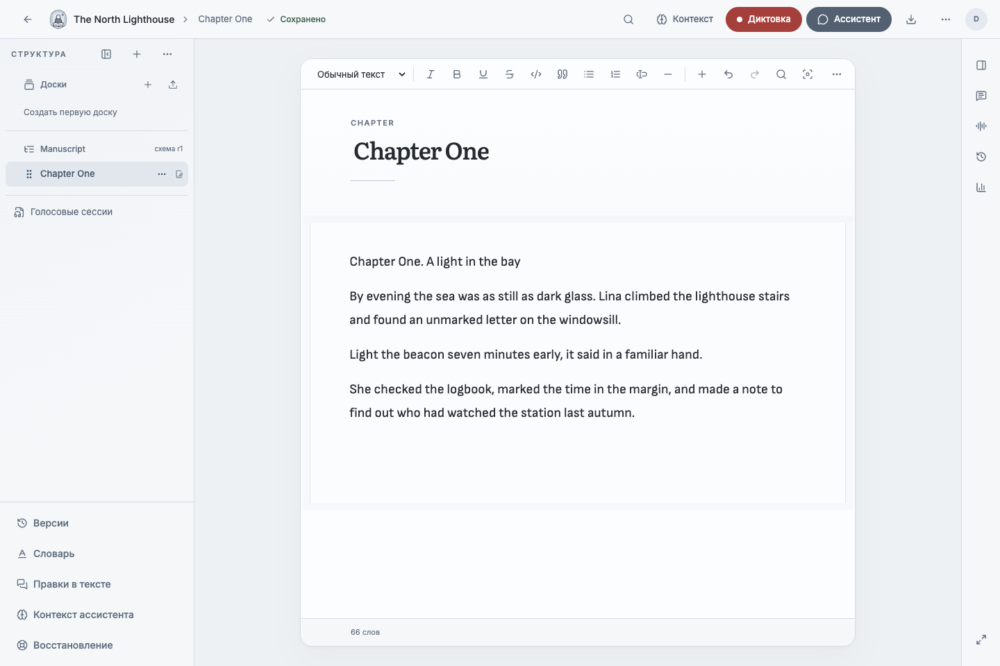

# Writer's Studio

[](https://github.com/avacadorun-dev/writers-studio/actions/workflows/ci.yml)
[](LICENSE)


A self-hosted writing workspace built with Go and React. Organize long-form work,
dictate drafts, check the original audio, develop ideas on visual boards, and
review assistant proposals before they change a manuscript.

> **Project status: frozen.** This repository preserves the Go/web edition as an
> open-source reference. Development is moving to a separate desktop application.
> Further feature development here is unlikely, and maintenance, security fixes,
> support, and response times are not guaranteed. Specifications document this
> edition's design; they are not a roadmap or commitments for the desktop project.

Licensed under [MIT](LICENSE).



The screenshot uses synthetic project data; the application controls remain Russian.

## What it does

- **Projects and manuscripts:** configurable document trees, a Tiptap/ProseMirror
  editor, autosave, named versions, search, replace, and source references.
- **Voice capture:** browser recording with local recovery, live transcription,
  separate source audio and transcript artifacts, transcript review, and explicit
  transfer into the manuscript.
- **Canvas:** visual notes, linked documents and media, drawing, typed cards,
  graph views, templates, and revision history.
- **Assistant:** scoped project tools, voice or chat, project guidance and memory,
  exact change previews, explicit Apply/Reject, and compensating Undo.
- **Portability:** reader exports, Markdown directory migration, and `.wstudio`
  archives carrying project data and history without account credentials.
- **Self-hosting:** PostgreSQL and S3-compatible storage, a Docker Compose stack,
  and an optional project-scoped MCP gateway for trusted LAN/VPN use.

The application interface remains primarily Russian. Repository documentation
and built-in help are English. The previously started multilingual-interface
experiment is not part of this publication.

## Quick start

Install Docker Engine with Compose v2, then from the repository directory:

```sh
cp .env.example .env
docker compose up --build -d
docker compose ps
curl -fsS http://localhost:8080/api/health
```

Open [localhost:8080](http://localhost:8080) and create an application account.
Account registration does not require provider keys. Without configured speech
or model providers, their features report that they are unavailable; ordinary
writing and project management remain usable.

The default Compose stack uses **development credentials** and binds the web app
to loopback. Use the [deployment guide](docs/DEPLOYMENT.md) for a LAN installation.
Browser microphone access requires localhost or trusted HTTPS.

Stop while retaining data:

```sh
docker compose down
```

`docker compose down -v` deletes the development database and object-storage
volumes. Back up manuscripts and audio before removing volumes.

## Optional speech and assistant providers

Edit your local, Git-ignored `.env`. Provider credentials belong on the server;
never put them in `VITE_*` variables, client code, screenshots, or issues.

| Feature | Configuration |
| --- | --- |
| Live speech recognition | `DEEPGRAM_API_KEY`; optionally `LIVE_STT_ADAPTER=deepgram` |
| Explicit re-transcription / speech fallback | `OPENROUTER_API_KEY`; optionally `STT_ADAPTER=openrouter` |
| System assistant | `LLM_BASE_URL`, `LLM_API_KEY`, `LLM_MODEL`, `LLM_DIALECT` |
| Encrypted user provider connections | Stable `LLM_CREDENTIAL_ENCRYPTION_KEY` |
| Remote MCP | Production configuration, `MCP_ENABLED=true`, and a separate `MCP_OAUTH_SECRET` |

See [.env.example](.env.example), the [configuration guide](docs/CONFIGURATION.md),
and [MCP architecture](docs/adr/ADR-008-remote-mcp-gateway.md).
Providers have their own processing, retention, and billing policies. Selecting a
provider can send audio or selected project material to that provider.

## Architecture

```text
Browser / React PWA
  ├─ Tiptap editor and React Flow Canvas
  ├─ IndexedDB recovery for unfinished local work
  └─ HTTP + WebSocket
         Go modular monolith
           ├─ HTTP API, authentication and project services
           ├─ speech gateway and durable background jobs
           ├─ assistant orchestration and scoped MCP tools
           ├─ PostgreSQL: projects, revisions, jobs and metadata
           └─ S3-compatible storage: audio, images and exports
```

Source audio, immutable transcription artifacts, editable transcript drafts,
manuscript revisions, and assistant proposals are separate objects. A late
transcription result does not silently overwrite an author's edits.

## Local development

Requirements: Go 1.26+, Bun, PostgreSQL 17, and S3-compatible storage. Docker Compose
can supply the services. Frontend commands use Bun; dependencies are locked in
`bun.lock` and `go.sum`.

```sh
bun install --frozen-lockfile
docker compose up -d db storage
# In separate terminals, with server configuration exported into the environment:
go run ./cmd/server
bun run dev
```

The frontend dev server runs on port 5173 and proxies `/api` to port 8080. The Go
server reads environment variables; it does not automatically load `.env` outside
Compose. Never source an environment file from an untrusted source.

## Verification

```sh
bun run release:check
bun run check
bun run type-check
bun run test
bun run build
go test ./...
go test -race ./...
go vet ./...
```

Database integration tests and Playwright require additional services. See
[CONTRIBUTING.md](CONTRIBUTING.md) and the
[verification guide](docs/implementation/VERIFICATION_REPORT.md).

## Documentation

| Document | Purpose |
| --- | --- |
| [Documentation index](docs/README.md) | Architecture, specifications, decisions and release records |
| [Product brief](PRODUCT_BRIEF.md) | Product intent and boundaries of the frozen edition |
| [Architecture](docs/architecture/ARC42.md) | Components, persistence, runtime flows and trust boundaries |
| [Workflows](docs/specification/WORKFLOWS.md) | End-to-end behavior and acceptance identifiers |
| [Assistant specification](docs/specification/ASSISTANT_MODE.md) | Tools, scope, staging, providers and recovery |
| [Built-in help](content/docs/index.mdx) | User guides, also available at `/docs` in a running app |
| [Deployment](docs/DEPLOYMENT.md) | Installation, TLS, upgrades and backups |
| [Security policy](SECURITY.md) | Reporting and deployment responsibilities |
| [Publication guide](docs/PUBLICATION.md) | Local checks and safe Git publication |

## Contributing and support

Forks and independent reuse are welcome under the MIT license. Read
[CONTRIBUTING.md](CONTRIBUTING.md) before preparing changes. This frozen repository
does not promise issue triage or pull-request review. Do not use public issues to
share provider keys, recordings, manuscripts, database dumps, or private server
addresses.
