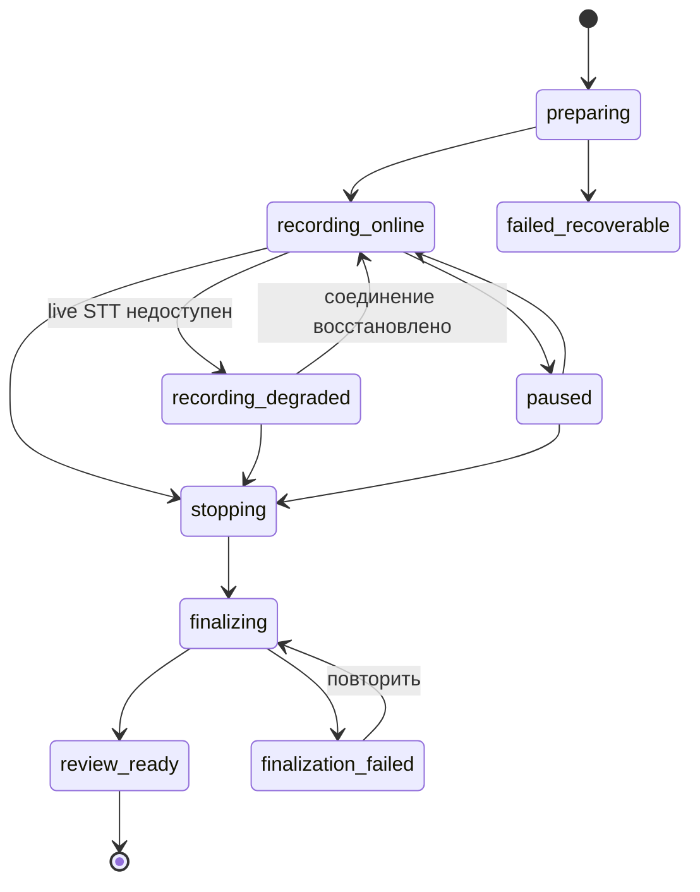

# ADR-001: Capability-based двухконтурное распознавание речи

> Статус: принято с обязательным техническим спайком  
> Дата: 29 июля 2026  
> Владельцы: Product + Engineering

### Implementation note — 30 июля 2026

Текущая production-интеграция реализует два независимых контура, но не запускает
оба для каждой успешной записи:

- `realtime`: browser AudioWorklet передаёт mono PCM16 небольшими transport-frames,
  gateway держит одно непрерывное WebSocket-соединение с Deepgram Nova-3 и
  нормализует `partial`, `segment_final`, utterance events, word timestamps и
  confidence;
- `file`: OpenRouter с `response_format=verbose_json`, segment и word timestamps
  запускается по явной команде повторной расшифровки или как fallback, если live
  отсутствовал/не подтвердил финализацию.

Transport-frame не является абзацем или законченным фрагментом текста. Partial
заменяется на месте, соседние provider finals склеиваются пробелами в один prose-run,
и один draft-абзац, а голосовая команда остаётся явной границей. Успешный Deepgram
`Finalize` делает `live_final` основным source transcript без автоматического
OpenRouter-прохода. При `LIVE_STT_ADAPTER=auto` наличие серверного
`DEEPGRAM_API_KEY` выбирает Deepgram; `STT_ADAPTER=auto` независимо выбирает
OpenRouter при наличии `OPENROUTER_API_KEY`. Без ключей или при явном `fake`
используется детерминированный adapter. Browser E2E с реальным русским WAV проверяет
live-текст, склейку, отсутствие batch artifact, timestamps и отсутствие fixture-фразы.

## Контекст

Главная функция «Студии автора» — диктовка длинного авторского текста. Пользователь должен видеть слова по мере речи, но также получать максимально стабильную расшифровку после окончания записи.

Предложенный file-STT вызов является хорошей первой benchmark-интеграцией:

```bash
AUDIO_BASE64=$(base64 < audio.wav | tr -d '\n')

curl https://openrouter.ai/api/v1/audio/transcriptions \
  -H "Content-Type: application/json" \
  -H "Authorization: Bearer $OPENROUTER_API_KEY" \
  -d '{
    "model": "openai/whisper-large-v3-turbo",
    "input_audio": {
      "data": "'"$AUDIO_BASE64"'",
      "format": "wav"
    },
    "language": "ru"
  }'
```

Он подходит для уже записанного файла. Опубликованный STT-контракт OpenRouter принимает base64-аудио и возвращает завершённый результат. Документированного WebSocket/WebRTC-контракта с изменяемыми partial-гипотезами для этого endpoint нет. Общая документация OpenRouter о streaming относится к потоковой выдаче модельного ответа и не должна считаться доказательством live-STT для `/audio/transcriptions`.

Это **не выбор обязательной модели или провайдера**. В 2026 году существуют cloud и open-weight решения с разными преимуществами: нативный streaming, self-hosting, word timestamps, vocabulary biasing, более новая модельная архитектура или меньшая стоимость. Архитектура должна выбирать по возможностям и измерениям, а не по OpenAI-совместимой форме endpoint.

При этом живой текст и финальный текст решают разные задачи:

- **live-текст** подтверждает, что приложение слышит автора, и поддерживает ощущение потока;
- **финальный текст** исправляет нестабильные гипотезы, пунктуацию и ошибки на границах фраз;
- **исходное аудио** остаётся источником восстановления;
- **авторский текст** может отличаться от обоих и никогда не должен быть автоматически перезаписан.

## Решение

Использовать два логических контура за единым внутренним интерфейсом STT:

1. low-latency контур для живого UX;
2. quality-pass контур для стабильного source transcript.

Их могут обслуживать два разных провайдера, одна модель в двух режимах или self-hosted pipeline. Разделение является доменным, а не vendor-ограничением.

### Контур A: realtime

Realtime-провайдер получает короткие PCM-чанки во время записи и отдаёт:

- `partial` — изменяемую гипотезу для немедленного показа;
- `segment_final` — стабилизированный фрагмент;
- временные границы фрагмента или слов, если провайдер их предоставляет;
- событие конца реплики;
- событие ошибки или деградации.

Browser-клиент не связывается с внешним STT напрямую в базовой архитектуре: аудио проходит через защищённый realtime gateway приложения, который хранит ключи и нормализует события.

Для первого benchmark набора сравниваются как минимум:

- OpenAI `gpt-live-transcribe`;
- Deepgram Nova-3 streaming с русским языком и interim results;
- ElevenLabs Scribe v2 Realtime;
- Mistral Voxtral Mini Transcribe Realtime;
- один self-hosted/open-weight вариант, если доступна целевая GPU/CPU-конфигурация.

AssemblyAI `whisper-rt`, Google Chirp 3 и новые подходящие модели остаются допустимыми кандидатами. Shortlist пересматривается перед спайком, чтобы спецификация не закрепляла состояние рынка на дату документа.

### Контур B: quality pass / финализация

После остановки полная, локально сохранённая запись передаётся в выбранный finalizer. Он обязан:

- поддерживать русский язык на подтверждённом уровне качества;
- возвращать segment timestamps;
- по возможности возвращать word timestamps и confidence;
- принимать vocabulary/context hints либо проходить benchmark без них;
- обрабатывать длинную запись без неявной потери фрагментов;
- быть детерминированным настолько, насколько позволяет модель;
- сохранять результат как новый immutable transcript artifact;
- предоставлять измеримые latency, cost и data-retention характеристики.

Первый benchmark adapter — `openai/whisper-large-v3-turbo` через OpenRouter. Это дешёвый и быстрый baseline, а не production default.

Другие обязательные классы кандидатов:

- cloud batch STT нового поколения, например ElevenLabs Scribe v2 или сопоставимые модели;
- единый cloud provider, который даёт и live, и final режим;
- self-hosted Faster-Whisper с подходящей multilingual Whisper checkpoint;
- open-weight realtime модель, например Mistral Voxtral Mini Transcribe Realtime, если русский язык проходит benchmark;
- локальный/desktop Whisper.cpp для privacy/offline режима;
- отдельный alignment pass, например WhisperX, если лучшая ASR-модель не даёт нужных word timestamps.

Faster-Whisper — inference engine, а не единственная модель: checkpoint, decoding parameters, VAD, hardware и alignment фиксируются как версия pipeline.

### Правило слияния

- Partial-текст является только визуальной гипотезой и не входит в историю документа.
- `segment_final` формирует черновик текущей сессии.
- Batch-результат становится `source transcript`, если автор ещё не начал редактирование.
- Если автор начал редактирование до окончания batch-задачи, новый результат показывается как сравнение/предложение и не заменяет рабочий текст.
- После переноса в manuscript-редактор связь с аудио сохраняется на уровне абзаца; word-level подсветка включается только при наличии надёжных timestamps.
- Любое автоматическое литературное «очищение» создаёт отдельную производную версию.

## Почему не фиксировать один OpenAI-совместимый Whisper endpoint

Преимущества исходного baseline:

- русский и многоязычная речь;
- низкая стоимость;
- высокая скорость обработки готового файла;
- возможность повторной расшифровки исходной записи;
- через прямой Groq-контракт для той же модели доступны segment/word timestamps.

Но быстрый inference готового файла не равен истинному streaming ASR. Нарезка речи на маленькие файлы и повторные POST-запросы:

- даёт текст только после завершения каждого окна;
- ухудшает контекст на границах;
- требует удаления дубликатов из перекрывающихся окон;
- усложняет порядок ответов;
- при минимальной тарификации коротких запросов может быть экономически невыгодной;
- не имеет стабильной семантики partial/final.

Поэтому chunked file-ASR допустим как эксперимент или fallback, но не считается нативным streaming только из-за высокой скорости inference.

## Карта кандидатов

Это исследовательская карта, а не ranking. Поддержка русского и data policy перепроверяются на дату спайка.

| Кандидат | Развёртывание | Native live partials | Timestamps | Роль в benchmark |
|---|---|---:|---|---|
| OpenRouter + Whisper Large V3 Turbo | Cloud | Нет документированного live-STT | Проверить passthrough | Дешёвый file baseline |
| Groq + Whisper Large V3/Turbo | Cloud | File/chunked | Word + segment | Whisper baseline с metadata |
| Faster-Whisper | Self-hosted | Не нативный; возможен chunked pipeline | Word + segment | Privacy/cost baseline |
| Whisper.cpp | On-device/self-hosted | Есть naive streaming example | Зависит от pipeline | Offline/desktop feasibility |
| OpenAI GPT Live Transcribe | Cloud | Да | Проверить на нужной гранулярности | Low-latency reference |
| Deepgram Nova-3 | Cloud | Да | Word + segment | Русский live benchmark |
| ElevenLabs Scribe v2 Realtime / Scribe v2 | Cloud | Да | Word-level | Единая live + final семья |
| Mistral Voxtral Mini Realtime | Cloud/open weights | Да | Проверить normalized contract | Open-weight native streaming |
| Google Chirp 3 | Cloud | Да | Utterance; word support ограничен | Enterprise benchmark |
| AssemblyAI Whisper RT | Cloud | Да | Word-level в событиях | Multilingual control |
| WhisperX | Self-hosted post-process | Нет | Forced word alignment | Дополнительный aligner |

Добавление нового кандидата не требует изменения workflow или доменной модели: он реализует capability manifest и нормализованные интерфейсы.

## Capability manifest

```ts
interface STTCapabilities {
  modes: Array<"realtime" | "chunked_live" | "file" | "alignment">;
  deployment: "cloud" | "self_hosted" | "on_device";
  languages: string[];
  partialResults: boolean;
  segmentTimestamps: boolean;
  wordTimestamps: boolean;
  confidence: "none" | "segment" | "word";
  vocabularyHints: "none" | "prompt" | "keywords" | "custom_model";
  supportsLongAudio: boolean;
  maxAudioSeconds?: number;
  dataRegion?: string;
  retentionClass: string;
}
```

Pipeline selector получает требуемые capabilities и policy, после чего выбирает только из заранее протестированных версий. Автоматический переход на неизвестную модель по маркетинговому alias запрещён для source transcript.

## Нормализованный контракт

```ts
type LiveTranscriptEvent =
  | {
      type: "partial";
      sessionId: string;
      providerTurnId: string;
      text: string;
      startMs?: number;
      endMs?: number;
    }
  | {
      type: "segment_final";
      sessionId: string;
      providerTurnId: string;
      segmentId: string;
      text: string;
      startMs: number;
      endMs: number;
      words?: Array<{
        text: string;
        startMs: number;
        endMs: number;
        confidence?: number;
      }>;
    }
  | {
      type: "speech_started" | "speech_stopped" | "stream_degraded";
      sessionId: string;
    }
  | {
      type: "error";
      sessionId: string;
      code: string;
      recoverable: boolean;
    };
```

```ts
interface FinalTranscript {
  artifactId: string;
  sessionId: string;
  pipelineVersion: string;
  provider: string;
  model: string;
  language: string;
  text: string;
  segments: TranscriptSegment[];
  createdAt: string;
  provenance: {
    audioAssetId: string;
    audioSha256: string;
    providerRequestId?: string;
  };
}
```

В доменной модели не сохраняются внешние event names. Каждый provider adapter обязан преобразовать их в этот контракт.

## Состояния live-сессии



`recording_degraded` не останавливает локальную запись. Пользователь видит, что живой текст временно недоступен, но голос продолжает безопасно сохраняться.

## Критерии выбора STT pipeline

Веса применяются к реальному русскоязычному benchmark, а не к маркетинговым цифрам.

| Критерий | Вес |
|---|---:|
| Точность на русской художественной диктовке | 30% |
| Точность имён, топонимов и вымышленных терминов | 15% |
| Медианная и p95 задержка partial/final | 15% |
| Стабильность partial-текста | 10% |
| Word/segment timestamps | 10% |
| Работа при паузах, самокоррекциях и длинных фразах | 10% |
| Полная стоимость владения и лимиты | 5% |
| Data controls, лицензия и региональность | 5% |

Ни один provider/model/pipeline не считается выбранным для production, пока не пройдёт одинаковый корпус записей. Для self-hosted варианта в стоимость включаются GPU/CPU, эксплуатация, cold start и инженерная поддержка.

## Benchmark-корпус

Минимум 60 минут аудио:

- 20 минут чистой русской прозы;
- 10 минут диалогов с тире и кавычками;
- 10 минут имён и вымышленных терминов;
- 10 минут с самокоррекциями, повторами и длинными паузами;
- 5 минут на встроенном микрофоне в умеренном шуме;
- 5 минут смешанной русско-английской речи.

Измеряются:

- WER/CER;
- term recall по словарю проекта;
- время до первого partial;
- время стабилизации сегмента;
- доля текста, изменившаяся после первого показа;
- процент сегментов без корректных timestamps;
- стоимость часа;
- число разрывов потока.

## Последствия

### Положительные

- UX живой диктовки не зависит от batch-модели.
- Можно выбрать лучший finalizer, не меняя UX диктовки.
- Можно менять провайдера без изменения доменной модели и экранов.
- Self-hosted и on-device варианты являются полноценными архитектурными опциями.
- Сбой live-STT не приводит к потере аудио.
- Авторские правки защищены от позднего batch-ответа.

### Отрицательные

- Два STT-запуска увеличивают стоимость.
- Требуется reconciliation между live- и final-текстом.
- Realtime gateway усложняет backend и наблюдаемость.
- Словарь проекта приходится преобразовывать под разные provider contracts.
- Capability matrix и pipeline versions требуют постоянного сопровождения.

## Обязательные проверки до реализации

- [ ] Обновить shortlist по доступным моделям на дату спайка.
- [x] Проверить OpenRouter Whisper как file baseline, включая русский, timestamps и полный response contract.
- [x] Подключить Deepgram Nova-3 как native realtime pipeline и проверить русский WAV,
  partial/final contract, word timestamps и склейку provider finals.
- [ ] Сравнить минимум три native realtime pipeline, включая один open-weight/self-hosted вариант.
- [ ] Сравнить минимум три quality-pass pipeline, включая Faster-Whisper.
- [ ] Зафиксировать checkpoint, decoding, VAD, alignment и hardware для каждого self-hosted результата.
- [ ] Провести слепую оценку читаемости текста авторами, кроме WER/CER.
- [ ] Проверить поведение live-контура при 2–10 секундах потери сети.
- [ ] Проверить запись и восстановление 60-минутной сессии в браузере.
- [ ] Зафиксировать data retention, регион, лицензию и полную стоимость каждого finalist.
- [ ] Выбрать primary и fallback только после публикации benchmark report.

## Источники

- [OpenRouter: Create transcription](https://openrouter.ai/docs/api/api-reference/transcriptions/create-audio-transcriptions)
- [OpenRouter: Whisper Large V3 Turbo](https://openrouter.ai/openai/whisper-large-v3-turbo)
- [OpenRouter: Streaming](https://openrouter.ai/docs/api_reference/streaming)
- [OpenAI: Realtime transcription](https://developers.openai.com/api/docs/guides/realtime-transcription)
- [OpenAI: GPT Live Transcribe](https://developers.openai.com/api/docs/models/gpt-live-transcribe)
- [Deepgram: Live streaming audio](https://developers.deepgram.com/docs/live-streaming-audio)
- [Deepgram: Interim results](https://developers.deepgram.com/docs/interim-results)
- [Deepgram: Models and languages](https://developers.deepgram.com/docs/models-languages-overview/)
- [AssemblyAI: Whisper streaming](https://www.assemblyai.com/docs/universal-streaming/multilingual-transcription)
- [Groq: Speech to Text](https://console.groq.com/docs/speech-to-text)
- [Faster-Whisper](https://github.com/SYSTRAN/faster-whisper)
- [Whisper.cpp](https://github.com/ggerganov/whisper.cpp)
- [WhisperX](https://github.com/m-bain/whisperX)
- [ElevenLabs: Realtime Speech to Text](https://elevenlabs.io/docs/eleven-api/guides/how-to/speech-to-text/realtime/server-side-streaming)
- [ElevenLabs: Transcription models](https://elevenlabs.io/docs/overview/capabilities/speech-to-text)
- [Mistral: Realtime transcription](https://docs.mistral.ai/studio-api/audio/speech_to_text/realtime_transcription)
- [Mistral: Audio models](https://docs.mistral.ai/studio-api/audio/overview)
- [Google: Chirp 3](https://cloud.google.com/speech-to-text/v2/docs/chirp-model)
