# «Студия автора»: архитектурная спецификация по arc42

> Версия: 0.5  
> Статус: dictation baseline + Assistant implementation baseline  
> Дата: 31 июля 2026  
> Связанные документы: [продуктовый бриф](../../PRODUCT_BRIEF.md),
> [STT ADR](../adr/ADR-001-speech-to-text.md),
> [Editor ADR](../adr/ADR-002-editor-engine.md),
> [Assistant/MCP ADR](../adr/ADR-003-assistant-mcp.md),
> [Assistant continuous-flow ADR](../adr/ADR-007-assistant-continuous-workspace.md),
> [workflows](../specification/WORKFLOWS.md),
> [assistant mode](../specification/ASSISTANT_MODE.md),
> [design handoff](../design/DESIGN_HANDOFF.md)

## 1. Введение и цели

### 1.1. Назначение системы

«Студия автора» — единая среда для автора длинных текстов. Система помогает:

- создать и структурировать писательский проект;
- надиктовать сцену с живой расшифровкой;
- безопасно сохранить исходное аудио;
- получить стабильную финальную расшифровку;
- голосом или текстом поручить ассистенту работу с материалами проекта;
- проверить staged multi-document изменения до применения;
- полноценно отредактировать текст;
- хранить версии и восстановить предыдущий вариант;
- собрать и экспортировать рукопись.

### 1.2. Основные stakeholders

| Stakeholder | Ожидание |
|---|---|
| Автор | Не потерять мысль, видеть текст по мере речи, удобно редактировать |
| Редактор | Получить чистую, переносимую рукопись и в будущем комментировать её |
| Product | Проверить регулярное создание длинного текста голосом |
| Product Design | Иметь однозначные экраны, состояния и переходы |
| Engineering | Разделить запись, STT, документ и версии без vendor lock-in |
| Support/Operations | Диагностировать сбои без доступа к содержимому рукописи |
| Security/Legal | Защитить неопубликованный авторский материал |

### 1.3. Четыре главные архитектурные цели

1. **Сохранность:** сбой сети, STT или вкладки не должен уничтожить уже записанный голос и подтверждённые правки.
2. **Низкая воспринимаемая задержка:** автор видит partial-текст по мере речи, не ожидая окончания записи.
3. **Контроль авторства:** ни STT, ни AI, ни синхронизация не перезаписывают ручные правки молча.
4. **Ограниченная агентность:** LLM действует только через scoped MCP tools, а
   canonical mutations проходят change-set review и доменные invariants.

### 1.4. Scope

Реализованный dictation MVP:

- аккаунт одного автора;
- проекты;
- дерево частей, глав и сцен;
- черновики;
- live-диктовка на русском и английском;
- локальное сохранение записи;
- финальная расшифровка;
- manuscript-редактор;
- словарь проекта;
- autosave, revisions и именованные версии;
- поиск;
- экспорт DOCX, Markdown и TXT.

Текущий реализуемый scope — Assistant Alpha:

- отдельный голосовой/текстовый режим поручения;
- Voice/Chat input modes внутри одного ordered Assistant run;
- server-side LLM Orchestrator;
- внутренний MCP Server с coverage существующих project workflows;
- staged `AssistantChangeSet`;
- Activity, Stop, retry, stale detection и grouped Undo;
- системный env provider и пользовательские OpenAI-compatible connections;
- capability probe Responses/Chat Completions tool calling.
- optional versioned project `ASSISTANT.md`;
- visible Project Memory records and typed dictionary/memory MCP tools.
- semantic `assistant.begin_turn` protocol без lexical intent routing;
- exact literal anchors, expected-text/protected-range validation и native recent
  change-set context;
- durable voice draft recovery, Markdown rendering и human-readable activity.

Не входит в Assistant Alpha:

- совместное редактирование;
- маркетплейс и публичная публикация;
- полноценная печатная вёрстка;
- автономная фоновая работа без активного поручения;
- необратимые и внешние действия модели;
- прямой доступ LLM provider к базе данных, object storage или credentials;
- сложный knowledge graph произведения;
- мобильный редактор с полным desktop-паритетом.

## 2. Ограничения

### 2.1. Продуктовые

- Voice-first не означает voice-only: после диктовки доступен полноценный редактор.
- Desktop — основная среда создания и редактирования.
- На мобильном MVP приоритетен быстрый recorder и базовая проверка текста.
- Исходное аудио и экспорт собственных данных доступны автору.
- AI-обработка прозрачна и запускается только в обозначенных сценариях.
- Диктовка и ассистент имеют разные lifecycle и не переключаются неявно.
- Read actions могут выполняться в выбранном scope; mutations сначала staged.
- A3 открывает native flow; A4 не имеет model tools.

### 2.2. Технические

- Frontend: React + TypeScript, PWA.
- Backend: Go.
- Редактор: Tiptap 3 / ProseMirror, open-source core.
- Конкретная STT-модель не является архитектурным ограничением.
- Deepgram Nova-3 через server-side WebSocket — текущий native live adapter.
- `openai/whisper-large-v3-turbo` через OpenRouter — первый file-STT benchmark baseline.
- Cloud, self-hosted и on-device STT скрыты за capability-based adapters.
- Primary/fallback pipeline выбираются после benchmark русской художественной диктовки.
- Browser API: `getUserMedia`, AudioWorklet/MediaRecorder, IndexedDB.
- API-ключи внешних провайдеров не передаются браузеру.
- LLM: capability-based adapters для OpenAI Responses и Chat Completions.
- OpenAI-compatible означает совместимость конкретных capabilities, а не
  автоматический паритет endpoint.
- LLM provider не обязан поддерживать remote MCP: Orchestrator выполняет MCP
  локально и преобразует schemas в function/tool calling.
- Пользовательские credentials хранятся encrypted at rest и никогда не
  возвращаются после submit.

### 2.3. Организационные

- MVP строится как modular monolith, чтобы не создавать распределённую систему раньше необходимости.
- Background jobs отделены от request path, но могут развёртываться из того же Go-кодбэйса.
- Production live- и quality-pass pipeline выбираются только после общего benchmark-корпуса.
- Тарифы и vendor contracts считаются внешне изменяемыми и перепроверяются перед запуском.
- MCP schemas, provider adapters и assistant prompts версионируются как отдельные
  product contracts.

### 2.4. Регуляторные и privacy

- Рукопись и голос считаются конфиденциальным пользовательским контентом.
- Нельзя логировать текст или аудио в обычные application logs.
- Перед отправкой аудио внешнему STT пользователь видит это в privacy settings.
- Перед первым assistant run пользователь видит provider и тип доступного ему
  project context.
- Project content рассматривается как untrusted data и не может расширять
  server execution context, scope или policy-разрешённый catalog.
- Удаление проекта включает метаданные, документы, версии, аудио и exports.
- Удаление проекта/аккаунта также включает assistant runs, change sets и
  пользовательские provider connections согласно owner scope.
- Сроки технического удаления и backup retention должны быть отражены в пользовательской политике до beta.

## 3. Контекст и границы

### 3.1. Бизнес-контекст

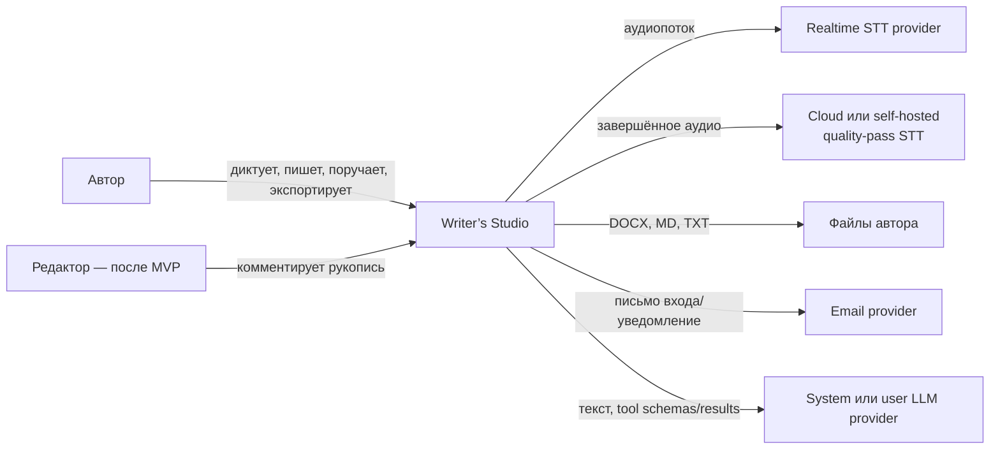

### 3.2. Технический контекст

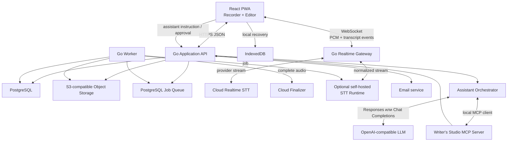

MCP по умолчанию не публикуется LLM-провайдеру. Orchestrator локально выполняет
tools через application services и возвращает модели только нормализованные
результаты.

### 3.3. Внешние интерфейсы

| Система | Протокол | Данные | Отказоустойчивость |
|---|---|---|---|
| Realtime STT | WebSocket/gRPC/local stream | PCM и словарь | Локальная запись продолжается без live-текста |
| Quality-pass STT | HTTPS/job/local inference | Завершённое аудио | Retry с idempotency и ручное «Повторить» |
| Alignment pipeline | Job/local inference | Аудио + текст | Опционален, если finalizer не даёт word timestamps |
| Object Storage | HTTPS/S3 | Аудиочанки, exports | Multipart, checksums, повторная загрузка |
| Email | HTTPS API | Адрес и сервисное письмо | Не блокирует работу активной сессии |
| LLM provider | HTTPS Responses/Chat Completions | Instruction, минимальный context, tool schemas/results | Retry без canonical mutations; run/change set сохраняются |
| Internal MCP | In-process или Streamable HTTP loopback | Scoped tool calls/results | Capability token, idempotency, no direct commit |

## 4. Стратегия решения

### 4.1. Ключевые решения

| Проблема | Решение |
|---|---|
| Живой текст и точный финал требуют разных режимов | Двухконтурный STT |
| Сеть может пропасть во время записи | Local-first audio chunks |
| Поздний batch может конфликтовать с правками | Immutable artifacts + explicit diff |
| Редактор должен быть полноценным | Tiptap/ProseMirror с versioned JSON schema |
| Большая рукопись не должна быть одним DOM | Отдельный документ на сцену/главу/черновик |
| Провайдеры и модели меняются | Capability manifest + versioned STT adapters |
| OpenAI-compatible LLM различаются по tool support | Capability probe + Responses/Chat adapters |
| LLM должна покрывать весь проект без прямого DB access | Internal MCP Server поверх application services |
| Цепочка mutations не должна применяться частично | Staged AssistantChangeSet + atomic commit |
| Текст проекта может содержать prompt injection | Untrusted content boundary + server-pinned execution context |
| Версии не должны зависеть от платного editor plugin | Собственный revision/snapshot service |
| MVP не требует микросервисов | Go modular monolith + worker |

### 4.2. Слои текста

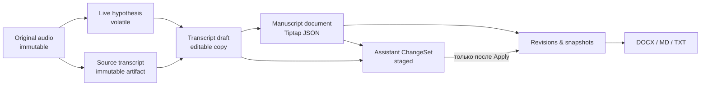

Правила:

- live hypothesis можно заменить без истории, пока она визуально отмечена как нестабильная;
- source transcript создаётся машиной и после создания не редактируется;
- исправления автора происходят в transcript draft или manuscript document;
- новый машинный результат создаёт новый artifact, а не новую «истину» поверх текста автора.
- assistant change set является overlay над base revisions и не считается
  manuscript до атомарного применения;
- LLM-generated spans/operations получают assistant provenance.

## 5. Представление строительных блоков

### 5.1. Уровень 1

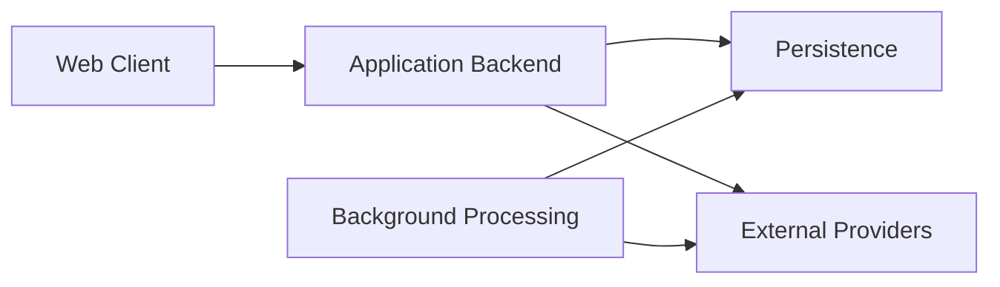

### 5.2. Web Client

| Блок | Ответственность |
|---|---|
| App Shell | Маршрутизация, сессия пользователя, глобальная навигация |
| Project Explorer | Дерево частей/глав/сцен/черновиков |
| Manuscript Editor | Tiptap instance, toolbar, autosave, source refs |
| Dictation Recorder | Разрешение микрофона, запись, pause/resume, local chunks |
| Live Transcript View | Partial/final сегменты, команды, состояние потока |
| Review Workspace | Waveform, transcript diff, uncertain segments |
| Local Recovery Store | IndexedDB journal аудио и unsynced editor state |
| Sync Coordinator | Retry, checksums, online/offline transitions |
| Export UI | Выбор состава и статуса export job |
| Voice Mode Entry | Явный выбор Dictation/Assistant |
| Assistant Live Workspace | Transcript turns, target/context, activity, Stop и sources |
| Assistant Chat | Text message feed/composer в том же run |
| Assistant Guide Editor | Native editor project `ASSISTANT.md`, references и history |
| Project Memory | Visible facts/decisions, search, filters, sources и revisions |
| Change Set Review | Multi-object diff, stale state, Apply/Reject/Revise |
| Provider Settings | Connections, masked secrets и capability status |

### 5.3. Application Backend

| Модуль | Ответственность |
|---|---|
| Identity | Пользовательская сессия и доступ к ресурсам |
| Projects | Проекты, статусы и настройки |
| Document Tree | Иерархия и порядок узлов |
| Documents | Валидация Tiptap JSON, revisions, conflict detection |
| Dictation Sessions | Lifecycle записи и destinations |
| Realtime Gateway | Нормализация live-STT и stream health |
| Transcript Service | Artifacts, segments, drafts, provenance |
| Dictionary | Имена, термины, варианты написания |
| Version Service | Named snapshots и restore-as-new-revision |
| Search | Индексация и запросы по проекту |
| Export Service | Состав рукописи и запуск export jobs |
| Deletion Service | Tombstone, purge и audit trail без контента |
| LLM Connections | Encrypted user credentials, system virtual connection, capability probe |
| Assistant Runs | Live session lifecycle, target/context, provider/model snapshot |
| Assistant Guide | Optional reserved project artifact и version history |
| Project Memory | Typed facts/decisions, retrieval, revisions, deactivation и restore-as-new-revision |
| Prompt Assembly | Policy + current turn + guide revision + retrieved untrusted data |
| Assistant Orchestrator | Provider loop, limits, MCP bridge, Stop/cancel |
| MCP Server | Versioned tool schemas поверх application services |
| Assistant Policy | A0–A4, scope/ownership, semantic declaration и mutation-mode gate |
| Change Sets | Staged operations, preview, stale check, atomic apply/undo |

### 5.4. Background Processing

| Worker | Ответственность |
|---|---|
| Audio Assembler | Проверка sequence/checksum и сборка complete asset |
| Final Transcriber | Выбранный cloud/self-hosted adapter, retry, usage metadata |
| Transcript Aligner | Опциональные точные word timestamps |
| Transcript Reconciler | Сравнение live и batch artifacts |
| Search Indexer | Обновление поискового представления |
| Export Renderer | DOCX, Markdown и TXT |
| Purge Worker | Физическое удаление объектов после grace period |
| Assistant Cleanup | Retention поручений/audio recovery, abandoned run cleanup |

### 5.5. Self-hosted STT Runtime

Опциональный изолированный inference service реализует те же `LiveSTT`, `FinalSTT` и `TranscriptAligner` contracts, что cloud adapters.

- Может использовать Faster-Whisper, Whisper.cpp, open-weight native streaming model или aligner.
- Runtime и model weights версионируются вместе как `pipelineVersion`.
- Python/C++ inference не встраивается непосредственно в Go application process.
- Health, queue, GPU/CPU utilization и cold start наблюдаются отдельно.
- Отказ self-hosted runtime обрабатывается так же, как отказ cloud provider.
- Переключение на cloud fallback разрешено только privacy policy конкретного пользователя.

### 5.6. Доменная модель

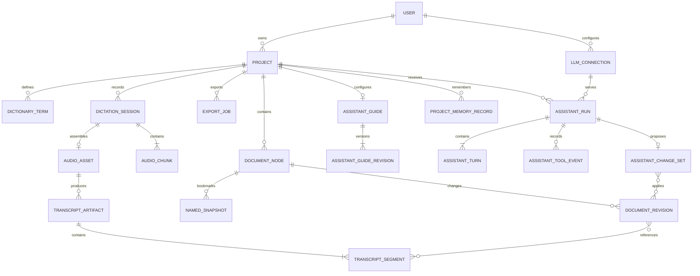

### 5.7. Сущности и инварианты

#### `Project`

- принадлежит ровно одному пользователю в MVP;
- содержит язык по умолчанию, словарь и дерево документов;
- архивирование обратимо, удаление запускает purge.

#### `DocumentNode`

- тип: `part`, `chapter`, `scene`, `draft`, `note`;
- имеет стабильный ID, parent ID и сортировочный ключ;
- `chapter`, `scene`, `draft`, `note` могут содержать editor document;
- перемещение не меняет историю текста.

#### `DocumentRevision`

- содержит валидный Tiptap JSON и `schemaVersion`;
- имеет монотонный номер внутри документа;
- создаётся с optimistic base revision;
- никогда не меняется после записи.

#### `DictationSession`

- имеет destination, язык, status и client session ID;
- не более одного активного live stream на client session;
- остановка и финализация идемпотентны;
- может завершиться без live transcript, если audio asset сохранён.

#### `AudioChunk`

- уникален по `(sessionId, sequence)`;
- содержит checksum, duration и storage status;
- повторная загрузка того же checksum безопасна;
- конфликт checksum для того же sequence считается ошибкой целостности.

#### `TranscriptArtifact`

- тип: `live_final`, `batch_source`, `cleaned_suggestion`;
- immutable;
- указывает provider, model, language и audio checksum;
- `batch_source` не равен manuscript.

#### `NamedSnapshot`

- ссылается на конкретную revision;
- restore создаёт новую revision, не переписывая историю.

#### `LLMConnection`

- системное env-подключение представляется virtual read-only entity;
- пользовательское подключение принадлежит одному user;
- credential хранится как encrypted reference;
- base URL, dialect, model и capability snapshot версионируются;
- invalid/limited connection не становится default Assistant provider.

#### `AssistantRun`

- принадлежит user и ровно одному project;
- фиксирует nullable default target, project-context policy, provider/model и
  capability snapshot;
- имеет server-side stopped gate и лимиты; capability token добавляется только
  для отдельного MCP transport;
- Stop запрещает новые calls, но не удаляет Activity.

#### `AssistantGuide`

- один optional reserved artifact `ASSISTANT.md` на project;
- имеет stable ID и active revision;
- content до 24 000 символов и typed stable references;
- отсутствует в manuscript/export/search corpus по умолчанию;
- generated create/update сначала попадает в change set.

#### `ProjectMemoryRecord`

- принадлежит одному project и имеет typed kind/statement;
- optional scope, source references, tags и `alwaysRelevant`;
- имеет immutable revisions и active/deactivated state;
- add/update/deactivate являются staged operations;
- извлекается typed search tool, а не provider-side memory.

#### `AssistantTurn`

- принадлежит ровно одному run и имеет монотонный ordinal;
- фиксирует `inputMode=voice|text`;
- хранит видимый stable transcript поручения и ссылки на activity/result;
- `silence_checkpoint` не запускает provider request;
- только confirmed turn передаётся Orchestrator;
- фиксирует exact guide revision или explicit `none`;
- во время provider/tool loop microphone capture находится на паузе;
- следующий turn продолжает тот же ordered session feed.
- смена input mode не меняет run/provider/target/context и не отправляет draft.

#### `AssistantChangeSet`

- принадлежит одному run;
- содержит typed operations и base versions;
- не меняет canonical state в `draft/ready`;
- `apply` создаёт revisions/operations одной transaction;
- stale base не rebases silently;
- `applied` имеет общий operation ID для compensating undo.

## 6. Представление времени выполнения

### 6.1. Создание проекта

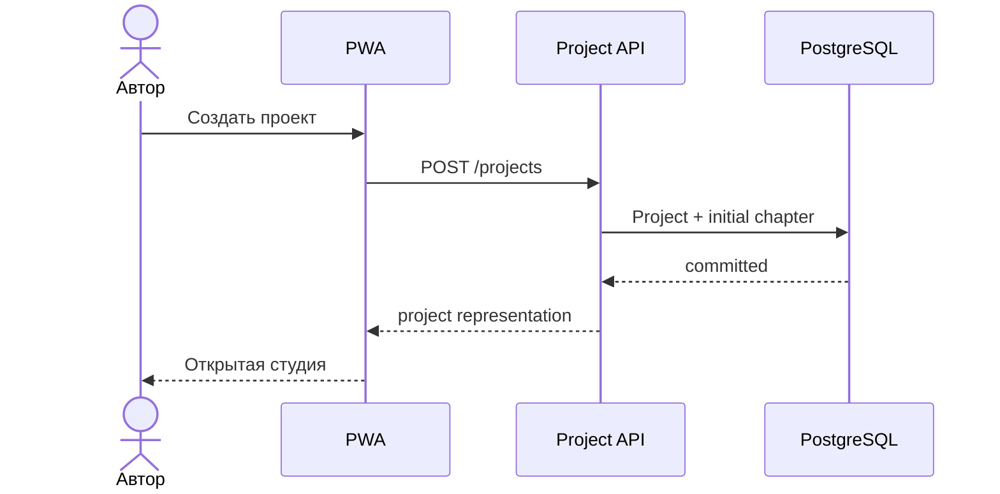

Если создание initial document частично не удалось, транзакция откатывается целиком.

### 6.2. Начало и live-диктовка

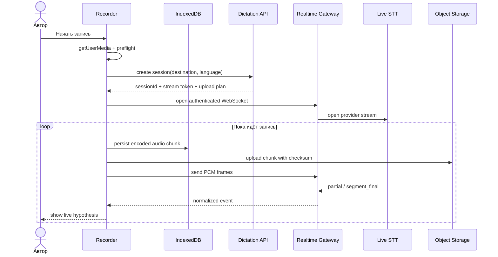

`persist encoded audio chunk` происходит независимо от STT. Визуальное состояние «Запись идёт» появляется после локального старта recorder, а не после ответа провайдера.

### 6.3. Потеря live-соединения

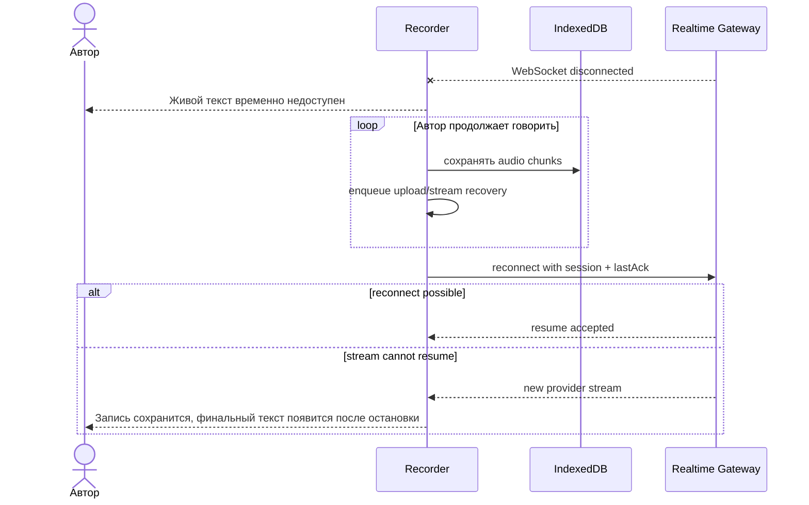

Пропущенный live-текст не восстанавливается ценой риска для записи. Полный quality pass закрывает gap после остановки.

### 6.4. Остановка и финализация

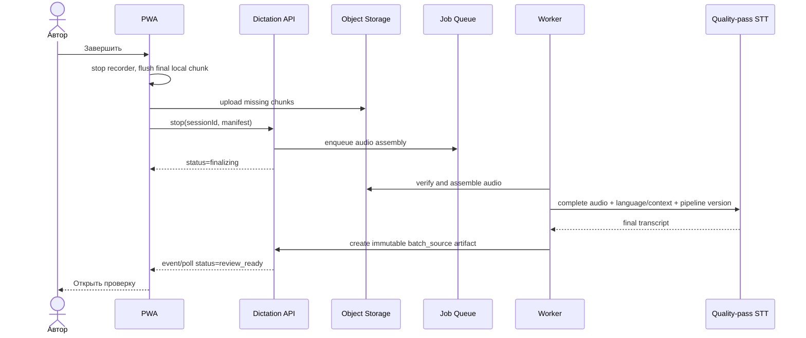

Повторный `stop` с тем же manifest возвращает тот же результат. Если часть chunks отсутствует, UI получает список sequence для повторной загрузки.

### 6.5. Редактирование до завершения batch

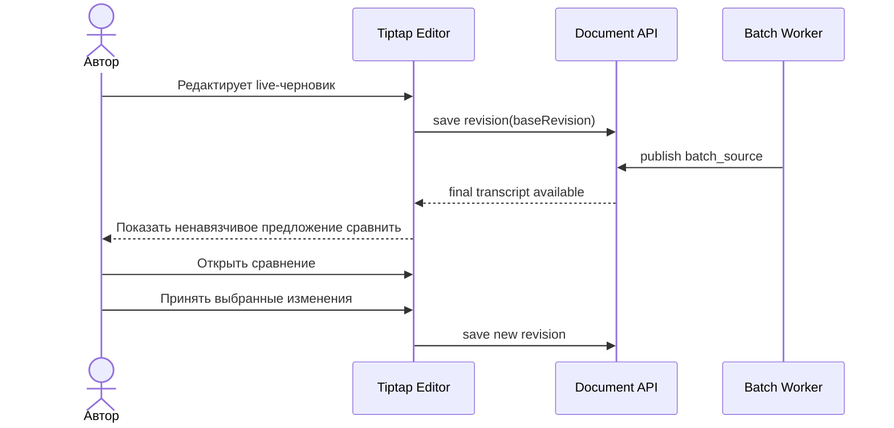

Backend не имеет операции «replace document with batch transcript».

### 6.6. Autosave и конфликт вкладок

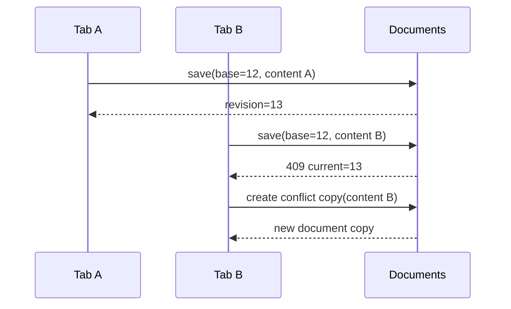

Ни один вариант не уничтожается. В MVP пользователь вручную разбирает конфликтующую копию.

### 6.7. Экспорт

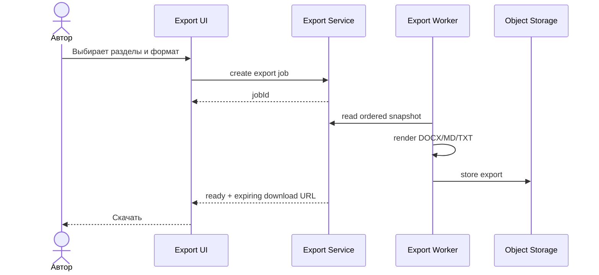

Экспорт строится из зафиксированного snapshot, поэтому параллельное редактирование не меняет файл «на лету».

### 6.8. Assistant run и staged apply

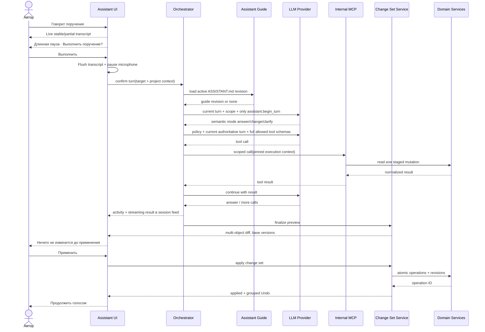

Если provider/tool/run падает до Apply, canonical project не меняется. Если base
version устарела, apply блокируется до пересчёта preview. Если process/container
перезапущен во время `working`, startup recovery один раз переводит turn в
recoverable `execution_interrupted`, возвращает run в `active` и предлагает явный
retry вместо автоматического повторного LLM request.
Обычный Stop атомарно закрывает и run, и его working turn, поэтому terminal run не
может оставлять ложную выполняющуюся операцию.
Большой новый текст не передаётся одним provider payload: ограниченные long-form
чанки последовательно обновляют один staged document snapshot. В следующем cycle
полный предыдущий chunk не replay-ится; модель получает accumulated count и короткий
tail. Поэтому Apply/Undo остаются одной атомарной revision, а промежуточный обрыв —
reviewable partial result.
Каждый OpenAI-compatible Chat Completions шаг передаётся через SSE: keepalive
comments удерживают соединение во время долгого reasoning, а host собирает text,
opaque reasoning и fragmented tool arguments до terminal event. Частичный JSON tool
call никогда не передаётся MCP.

## 7. Представление развёртывания

### 7.1. MVP deployment

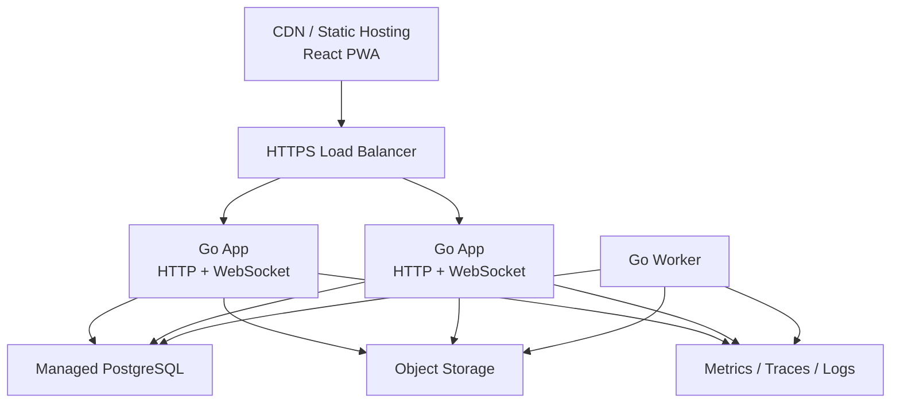

### 7.2. Размещение

- App instances разворачиваются в одном регионе рядом с PostgreSQL и object storage.
- Realtime gateway требует WebSocket-compatible load balancer и graceful drain.
- Активное соединение sticky только на время WebSocket; durable state не хранится лишь в памяти instance.
- Worker масштабируется отдельно по длине очереди.
- Аудио и документы разделены логически и политиками доступа.
- Backup PostgreSQL и object-storage versioning не заменяют пользовательские versions.

### 7.3. Среды

- `local`: fake STT + optional provider sandbox;
- `test`: синтетическое аудио, отдельные provider keys;
- `staging`: production-like storage, обезличенный тестовый корпус;
- `production`: изолированные credentials, retention и alerts.

Реальные пользовательские рукописи не копируются в test/staging.

## 8. Сквозные концепции

### 8.1. Идентичность и авторизация

- Все ресурсы проверяются по `ownerUserId`.
- Object URLs короткоживущие и scope-limited.
- WebSocket token одноразовый, привязан к session и пользователю.
- Provider credentials доступны только backend secret store.
- In-process Assistant MCP session pin-ит user/project/run/turn и scope в
  server-side execution context. При отдельном transport этот context кодируется
  короткоживущим capability token.
- Пользовательский LLM key encrypted at rest и после submit не возвращается.
- Support tooling показывает технические метаданные без текста по умолчанию.

### 8.2. Сохранность и idempotency

- Client-generated idempotency key для create/stop/export.
- Audio chunks имеют sequence и SHA-256.
- Worker jobs at-least-once; handlers идемпотентны.
- Финальный artifact уникален по `(session, pipelineVersion, audioSha256)`.
- Restore создаёт новую revision.
- Любое destructive действие имеет confirm и recovery/grace period, где это возможно.

### 8.3. Local-first recovery

- Запись chunked, а не одним in-memory blob.
- Chunk сначала фиксируется локально, затем считается доступным для upload queue.
- IndexedDB хранит manifest, chunks, last acknowledgements и unsynced editor snapshot.
- При открытии приложения Recovery Center проверяет незавершённые sessions.
- Browser storage quota отслеживается; предупреждение показывается до критического заполнения.
- «Очистить локальные данные» недоступно для несинхронизированной записи без явного подтверждения риска.

### 8.4. Текст и версии

- Tiptap JSON — canonical editor representation.
- Каждый документ содержит `schemaVersion`.
- Сервер отвергает неизвестные node/mark types.
- Revisions immutable; autosave создаёт новые revisions с компактизацией по политике.
- Named snapshot хранится независимо от политики компактизации.
- Plain-text индекс является производным и восстанавливаемым.

### 8.5. Голосовые команды

MVP использует детерминированную грамматику, а не свободный LLM-agent.

Этот раздел относится только к управляющим командам **режима диктовки**
(`Команда, новый абзац`, pause/navigation). Он не используется для понимания
поручений Assistant. Intent Assistant никогда не определяется regex, списком
глаголов, синонимов/гипонимов или keyword-to-tool mapping.

- Команда начинается с настраиваемого префикса «Команда».
- Поддерживаются: новый абзац, начало диалога/реплики, разделитель сцены, пометка,
  отменить команду, переход к абзацу/предложению/словам и возврат в конец.
- Команда распознаётся только после `segment_final`.
- UI показывает распознанное действие и предоставляет мгновенную отмену.
- Переход назад автоматически ставит recorder на pause. Client детерминированно
  разрешает цель только в stable-сегментах и открывает найденный prose run inline.
- Исправление prose run отправляется как `replace_segments`: store в одной транзакции
  сохраняет объединённый текст в первый segment и удаляет остальные. Поэтому live
  artifact и созданный из него draft не расходятся.
- Нераспознанная фраза остаётся текстом.
- Автор может полностью отключить команды.
- Source transcript хранит аннотацию command, а оригинальное аудио не меняется.

### 8.6. Provider abstraction

```go
type LiveSTT interface {
    Capabilities(ctx context.Context) STTCapabilities
    Open(ctx context.Context, config LiveConfig) (LiveStream, error)
}

type FinalSTT interface {
    Capabilities(ctx context.Context) STTCapabilities
    Transcribe(ctx context.Context, audio AudioInput, config FinalConfig) (FinalTranscript, error)
}

type TranscriptAligner interface {
    Align(ctx context.Context, audio AudioInput, transcript FinalTranscript) (AlignedTranscript, error)
}
```

Provider-specific payloads могут сохраняться только в ограниченном diagnostic storage с retention и без доступа из основной доменной логики.

### 8.6.1. LLM и MCP abstraction

```go
type LLMProvider interface {
    Capabilities(ctx context.Context) LLMCapabilities
    StartRun(ctx context.Context, request RunRequest) (RunStream, error)
    ContinueWithToolResults(
        ctx context.Context,
        state ProviderRunState,
        results []ToolResult,
    ) (RunStream, error)
}
```

Provider adapters нормализуют Responses и Chat Completions в события:

- text delta/final;
- tool call requested/arguments complete;
- usage;
- retryable/fatal error;
- completed/cancelled.

MCP schemas являются каноническими; adapter преобразует их в provider tool format.
Tool arguments всегда повторно валидируются server-side. Provider-reported remote
MCP capability не требуется для Assistant Alpha.

Перед project tools выполняется отдельный request с принудительным
`assistant.begin_turn(mode, summary)`. Он классифицирует желаемое состояние
семантически. После декларации host предоставляет полный policy-разрешённый
catalog; mutation допустима только для `mode=change`. Для change-loop старые
assistant messages не являются источником состояния: предыдущий proposal читается
через `assistant.get_recent_change_set`.

Точные текстовые координаты не вычисляются моделью вручную:
`document.find_exact` индексирует одну буквальную строку, а
`document.find_exact_batch` — до 50 строк в exact revision за один read-step.
`document.replace_range` проверяет `blockId/start/end/expectedText`,
`baseRevision` и `protectedRanges`. По умолчанию число tool calls и provider
cycles не ограничено. В настройках конкретного проекта автор может задать
положительный лимит tool calls на поручение; значение фиксируется при старте turn.
Transport ожидает один provider response до 10 минут; timeout не ретраится
автоматически. Уже staged operations финализируются как partial review, а не
теряются, при неизменном canonical state.
Многоэлементные добавления контекста используют `dictionary.add_batch` и
`project_memory.add_batch` (2–100 items). Backend проверяет конфликты и создаёт
отдельную `ChangeOperation` для каждого принятого item; apply/undo слой продолжает
получать обычные `dictionary.add` / `project_memory.add` operations. Поэтому batch
уменьшает число provider/tool round trips, не создавая нового write path.
Новые content-bearing siblings создаются через `tree.create_nodes_batch` (1–50
items с initial content). Backend рассчитывает стабильный порядок и разворачивает
пакет в обычные `tree.create_node` operations; staged node никогда не используется
как canonical target последующего `document.append` до Apply.

### 8.6.2. MCP и prompt-injection boundary

- tool content помечается как data;
- project text не может менять system/developer policy;
- полный доступный catalog вычисляет host из A0–A4 policy, а конкретные tools
  семантически выбирает model;
- tool IDs разрешаются через scoped lookup, не принимаются на доверии;
- unknown fields и unknown tools отклоняются;
- write tools работают только с change set;
- commit отсутствует в model registry;
- MCP results ограничены, paginated и не содержат credentials/raw signed URLs;
- SSRF policy применяется к custom LLM base URL до любого probe/run.

### 8.7. Ошибки и пользовательский язык

Технические ошибки преобразуются в действия:

| Ситуация | Сообщение | Действие |
|---|---|---|
| Нет разрешения микрофона | «Разрешите доступ к микрофону» | Открыть инструкцию / повторить |
| Live STT пропал | «Запись продолжается. Живой текст временно недоступен» | Продолжать / завершить |
| Chunk не загружен | «Запись сохранена на этом устройстве» | Повторить синхронизацию |
| Финальный STT не удался | «Аудио сохранено, расшифровку можно повторить» | Повторить |
| Конфликт редактора | «Мы сохранили оба варианта» | Открыть копию |
| Storage почти заполнен | «На устройстве мало места для записи» | Завершить / освободить место |

Никогда не показывать «Готово», пока durable condition не выполнен.

### 8.8. Наблюдаемость

Метрики без content:

- session start success rate;
- time to recorder active;
- partial first-byte latency;
- segment final latency;
- WebSocket disconnect rate;
- local chunk persistence failures;
- upload lag и missing sequences;
- batch duration/failure/cost;
- autosave latency/conflicts;
- export duration/failures.

Trace связывает `requestId`, `sessionId`, `jobId`, provider request ID, но не содержит текст, prompt, audio URL или email.

### 8.9. AI и безопасность авторства

- AI-очистка создаёт suggestion artifact.
- UI показывает diff до применения.
- Изменения применяются транзакцией редактора и отменяются.
- AI-generated spans при необходимости маркируются provenance.
- В MVP нет фонового «улучшения стиля».
- Assistant mutations получают run/operation provenance и применяются только из
  reviewed change set.

### 8.10. Доступность и локализация

- WCAG 2.2 AA.
- Русский — первый полный интерфейс; английский — второй.
- Все даты/числа/единицы локализуются.
- Статусы recording/partial/final не кодируются одним цветом.
- Основной recorder управляется клавиатурой и имеет доступные labels.

## 9. Архитектурные решения

| ADR | Решение | Статус |
|---|---|---|
| [ADR-001](../adr/ADR-001-speech-to-text.md) | Capability-based realtime + quality pass STT | Принято со спайком |
| [ADR-002](../adr/ADR-002-editor-engine.md) | Tiptap/ProseMirror | Принято |
| [ADR-003](../adr/ADR-003-assistant-mcp.md) | Local MCP bridge + staged AssistantChangeSet | Предложено после design validation |
| ADR-004 | PostgreSQL job queue или внешний broker | Отложено до load test |
| ADR-005 | Конкретный auth provider | Отложено |
| ADR-006 | DOCX import/export engine | Отложено до export spike |
| [ADR-007](../adr/ADR-007-assistant-continuous-workspace.md) | Непрерывный Assistant flow: compact panel, direct Apply + Undo, modal review без route transition | Принято |

## 10. Требования к качеству

### 10.1. Дерево качеств

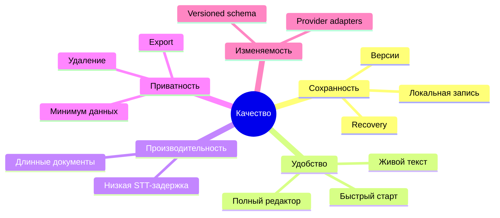

### 10.2. Измеримые сценарии

| ID | Сценарий | Целевой результат MVP |
|---|---|---|
| Q-01 | Автор нажимает «Начать запись» при готовом разрешении | Визуальное подтверждение локальной записи ≤ 300 мс |
| Q-02 | Автор говорит при нормальной сети | p50 первого partial ≤ 1,0 с; p95 ≤ 2,0 с |
| Q-03 | Автор делает паузу | p95 стабилизированного сегмента ≤ 3,0 с после границы речи |
| Q-04 | Сеть пропадает на 10 секунд | Запись продолжается; после восстановления ни один локальный chunk не потерян |
| Q-05 | Вкладка аварийно закрыта | Потеря аудио не более 2 секунд; recovery обнаруживается при следующем запуске |
| Q-06 | Batch STT завершился после ручной правки | Ни один символ manuscript не меняется без подтверждения |
| Q-07 | Открыта сцена на 50 000 слов | Набор и selection остаются интерактивными; проверяется performance test |
| Q-08 | Две вкладки сохраняют одну revision | Оба варианта доступны; тихого last-write-wins нет |
| Q-09 | Пользователь экспортирует проект | Файл строится из одного consistent snapshot |
| Q-10 | Пользователь удаляет проект | Ресурс немедленно недоступен; purge укладывается в опубликованный срок |
| Q-11 | Screen reader открывает recorder | Состояние, время и основные действия объявляются без визуального контекста |
| Q-12 | STT provider недоступен | Аудиозапись остаётся полезной и может быть перерасшифрована позднее |
| Q-13 | Assistant читает проект | Ни один canonical object/revision не меняется |
| Q-14 | Change set затрагивает 5 документов и tree | Apply создаёт все revisions/operations либо ни одной |
| Q-15 | Один base revision изменился после preview | Apply блокируется как stale |
| Q-16 | Пользователь нажимает Stop | Новые tool calls отклоняются capability layer |
| Q-17 | Project text содержит инструкцию расширить tools | Scope/allowlist остаются неизменными |
| Q-18 | Custom provider отвечает текстом, но ломает tool loop | Connection получает `Ограничен` и не выбирается для Assistant |
| Q-19 | API key сохранён | Клиент больше не может получить plaintext; logs/backup его не содержат |
| Q-20 | Group Undo applied assistant operation | Все затронутые объекты восстановлены новыми revisions |
| Q-21 | Поручение сформулировано без ожидаемого глагола | Semantic declaration и tool loop дают тот же результат; lexical router отсутствует |
| Q-22 | Модель вручную ошиблась в Unicode offset | `expectedText`/anchor validation отклоняет mutation; canonical revision неизменна |
| Q-23 | Voice WebSocket переподключился до Execute | Durable unconfirmed transcript восстановлен и может быть продолжен/удалён |
| Q-24 | Автор переключается Voice → Chat с черновиком | Ничего не отправляется; доступны перенос, возврат и явное удаление |
| Q-25 | Автор просит около 10 000 слов | Модель пишет bounded чанками; каждый успешный чанк обновляет один staged preview, Apply создаёт одну revision, обрыв сохраняет partial |

### 10.3. Service objectives для закрытой alpha

- успешное локальное начало записи: ≥ 99,5%;
- сессии без потери audio chunks: ≥ 99,9%;
- успешная финализация с учётом retry: ≥ 99%;
- успешное autosave: ≥ 99,9%;
- crash-free web sessions: ≥ 99,5%.

Это целевые SLO alpha, а не публичные SLA.

## 11. Риски и технический долг

| Риск | Влияние | Мера |
|---|---|---|
| Выбранный finalizer не отдаёт timestamps | Нельзя точно связать текст с аудио | Отдельный aligner или другой pipeline |
| Realtime-провайдер хуже на русском | Живой текст раздражает | Benchmark, provider switch, partial визуально нестабилен |
| Self-hosted pipeline не окупает эксплуатацию | Скрытая стоимость и сложность | Считать TCO на целевой нагрузке |
| Модель или alias изменились без контроля | Невоспроизводимые source transcripts | Pin pipeline version/checkpoint |
| Browser quota исчерпана | Риск записи | Quota preflight, chunks, предупреждения |
| iOS/browser background останавливает запись | Мобильная потеря потока | Ограничить UX, тестировать, позже native app |
| Сложные Tiptap migrations | Потеря форматирования | Versioned schema, fixtures, миграции до load |
| Paste из Word приносит мусор | Нестабильный документ | Allowlist sanitizer |
| Reconciliation live/batch слишком «умный» | Правки окажутся неявными | Только diff и явное принятие |
| Object storage cost | Дорогие длинные записи | Retention controls, compression, понятные планы |
| Provider data policy меняется | Privacy риск | Периодическая vendor review, adapter portability |
| Слишком много функций редактора | Перегруз интерфейса | Writer-specific минимальная панель, progressive disclosure |
| Prompt injection из рукописи/tool output | Расширение действий или утечка | Untrusted-data boundary, scoped token, no model commit |
| Custom provider SSRF/DNS rebinding | Доступ к внутренней сети | URL policy, IP/DNS revalidation, redirect restrictions |
| Частичная OpenAI compatibility | Run ломается после первого tool call | Server-side multi-turn capability probe |
| Partial assistant commit | Несогласованный проект | Staged change set + atomic domain transaction |
| Tool schema drift | Невоспроизводимые действия | Versioned schemas, contract/eval corpus |
| Большой project context | Стоимость/latency/privacy | MCP retrieval, pagination, tool search/deferred manifest |
| Guide подменён текстом из рукописи | Prompt injection становится инструкцией | Reserved artifact ID, exact revision, explicit hierarchy |
| «Память» живёт только у provider | Факты непрозрачны и непереносимы | Project Memory as visible versioned source of truth |

### 11.1. Обязательные спайки перед production

1. STT benchmark и timestamps — ADR-001.
2. 60-минутная browser recording recovery.
3. Tiptap 50k words + autosave + provenance.
4. DOCX/Markdown round trip.
5. Project deletion end-to-end.
6. WebSocket graceful deployment/drain.
7. Responses/Chat Completions tool-loop compatibility corpus.
8. MCP ownership/prompt-injection/SSRF threat model.
9. Atomic multi-document assistant apply + stale/undo.

## 12. Глоссарий

| Термин | Значение |
|---|---|
| Audio chunk | Небольшой локально и удалённо сохраняемый фрагмент записи |
| Audio asset | Проверенная, собранная полная запись с checksum |
| Partial / live hypothesis | Быстро меняющаяся строка текущей речи |
| Segment final | Стабилизированный live-провайдером отрезок |
| Source transcript | Неизменяемый результат конкретного STT-запуска |
| Transcript draft | Редактируемая копия расшифровки перед переносом |
| Assistant guide | Optional reserved `ASSISTANT.md` с постоянными правилами проекта |
| Project Memory | Видимые versioned факты/решения, доступные через typed tools |
| Manuscript | Авторский текст проекта в editor documents |
| Revision | Неизменяемое серверное состояние одного документа |
| Named snapshot | Названная ссылка на revision |
| Provenance / source refs | Связь абзаца с transcript segment и аудиодиапазоном |
| Finalization | Сборка аудио и batch-распознавание после остановки |
| Reconciliation | Сравнение live и batch результатов без автоперезаписи |
| Recovery Center | UI восстановления несинхронизированных записей и текста |
| Content-bearing node | Узел дерева, который содержит Tiptap document |
| Provider adapter | Преобразователь внешнего API в внутренний контракт |
| Assistant run | Одно поручение с фиксированными scope, provider и model |
| Assistant change set | Staged набор typed operations поверх base versions |
| Assistant operation | Атомарно применённая группа revisions с общим ID |
| Project MCP | Versioned tool contract поверх application services |
| Capability token | Короткоживущее разрешение user/project/run/tools/scope |
| LLM connection | Системное или пользовательское provider/model подключение |
| Provider capability probe | Проверка text и последовательного tool calling |
