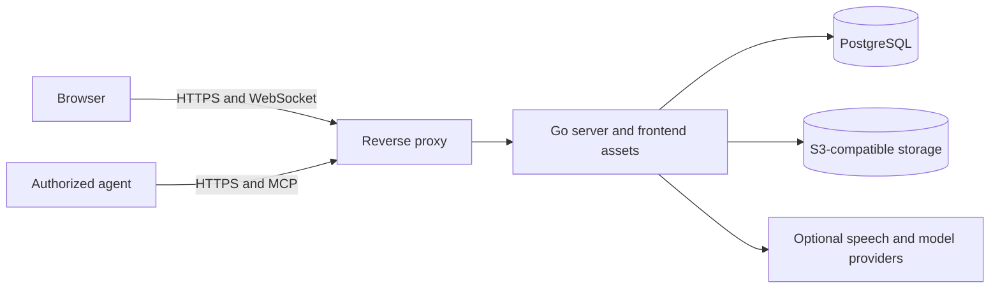

# Writer's Studio architecture

This document follows the [arc42 template](https://arc42.org/overview/). The
[OpenSpec capabilities](../../openspec/README.md) define observable behavior.

## 1. Introduction and Goals

Writer's Studio is a self-hosted Go/web workspace for long-form writing, voice
capture, source review, visual planning and controlled assistant actions. This
reference covers the Go server, browser client and their integration boundaries.

The main quality goals are preservation of confirmed work, useful live feedback,
author control over revisions, and bounded agent permissions.

| Stakeholder | Primary concerns |
| --- | --- |
| Author | Recover work, review source audio, and approve manuscript changes |
| Self-hosting operator | Configure providers and maintain complete backups |
| Integrator | Use owner-scoped HTTP and project agent interfaces |
| Maintainer | Preserve compatibility, revision guarantees and deployment isolation |

## 2. Architecture Constraints

The server is a modular monolith. React/TypeScript, Tiptap/ProseMirror and React
Flow form the browser client. PostgreSQL stores canonical metadata and revisions;
S3-compatible storage holds binary objects. IndexedDB retains unfinished browser
work. External STT and LLM services are accessed through server-side adapters.

The supported deployment model is a single-author account with owner-scoped
projects. Concurrent assistant runs are supported; collaborative real-time
editing and automatic public publishing are outside this edition.

## 3. Context and Scope

Authors use the browser workspace. Operators configure storage and optional
speech and model providers. An external agent can use a separately authorized
project connection. Automated publishing and real-time coauthoring are outside
the Go/web edition's scope.

| Boundary | Responsibility |
| --- | --- |
| Browser → server | Authenticated HTTP/WebSocket, validation and owner scope |
| Server → PostgreSQL | Transactions, revisions, jobs, grants and durable history |
| Server → object storage | Private audio/media/export objects and integrity metadata |
| Server → speech provider | Explicit audio processing, normalized events and errors |
| Server → model provider | Scoped selected context, strict tools and credential isolation |
| External agent → MCP | Authenticated project grants, server-owned session context |

Manuscripts, audio, transcripts, assistant history and provider credentials are
sensitive. Technical logs must omit their content. Project text and tool results
are untrusted data and cannot expand the assistant's permissions.

## 4. Solution Strategy

Keep capture, recognition, editorial work and assistant proposals separate.
Preserve immutable source artifacts and append document revisions. Use optimistic
base revisions to detect conflicts; preserve alternate work rather than losing it.
Run background jobs independently of browser pages. Stage model mutations and
apply selected dependency-consistent groups atomically.

## 5. Building Block View

| Package / area | Role |
| --- | --- |
| `cmd/server` | Server composition and process lifecycle |
| `internal/httpapi` | HTTP routes, authentication, validation and WebSocket gateways |
| `internal/store` | Owner-scoped PostgreSQL operations and additive migrations |
| `internal/stt` | Capability-based speech adapters and event normalization |
| `internal/llm` | Provider adapters, probes and encrypted credentials |
| `internal/projectmcp` | Internal project tool catalog and execution policy |
| `internal/assistant` | Run/turn/change-set models and orchestration contracts |
| `internal/editor` | Canonical rich-document validation and exact operations |
| `internal/canvas` | Snapshot validation, typed metadata and transfer contracts |
| `internal/export` | Snapshot-based reader output |
| `internal/markdowntree` | Bounded semantic Markdown tree migration |
| `src/app` | Providers, routes and application composition |
| `src/pages`, `widgets`, `features`, `entities`, `shared` | Feature-Sliced frontend layers |

Dependencies flow downward through frontend layers. Public slice entrypoints hide
implementation details. Shared UI is domain-agnostic. Bun and Biome are the
frontend runtime/package-manager and formatter/linter conventions.

## 6. Runtime View

### Manual editing

Load a revision, edit locally, persist an emergency snapshot and submit a new
revision with its base. Acknowledgement updates save status without resetting
editor content, selection or undo history. A stale write produces a conflict
path/copy. Version restoration appends a compensating revision.

### Dictation

Preflight verifies microphone access, recording capability, available storage,
destination and recognition configuration. MediaRecorder stores source chunks;
AudioWorklet sends live PCM frames independently. Local capture continues during
recognizer/network failure. Uploads are idempotent and acknowledged separately.

Successful Deepgram finalization promotes stable live segments to the immutable
source transcript. A quality pass or re-transcription is a separate artifact;
manual drafts remain unchanged until an explicit comparison/acceptance step.
Source references connect manuscript blocks to bounded audio intervals.

### Assistant

A run pins provider/model, visible target, permitted context and guide revision.
Every turn starts with semantic `assistant.begin_turn`. Read tools retrieve bounded
context; write tools accumulate proposals. The user reviews exact changes before
Apply. Base revisions, expected text, anchors and protected ranges are checked
again in the transaction. Undo restores before-snapshots using new revisions.

Voice and chat share a run. Editable voice drafts survive reconnect and never
submit merely because input mode changed. Hiding a panel or switching conversations
does not cancel background execution. Stop explicitly cancels further work.

### Export and import

Reader exports use a stable ordered snapshot rather than rereading moving data.
Native archives transfer the complete project with remapped IDs and validated
binary objects. Markdown migration preserves semantic text, paths and references,
while excluding account/provider state and complete runtime history.

## 7. Deployment View

PostgreSQL stores projects, document trees/revisions, named versions, annotations,
transcript artifacts/drafts, jobs, guide/memory history, assistant activity and MCP
grants. Object storage stores audio, project media and generated exports.
IndexedDB stores local audio manifests/chunks and emergency editor/Canvas snapshots.

The standard Compose stack is a local development environment. Production uses
separate credentials and trusted HTTPS. Database and object-storage backups must
be coordinated; encryption keys are backed up securely outside Git.

## 8. Crosscutting Concepts

- Authentication establishes the owner; resource lookup validates project ownership.
- Scope and active project are server-owned, never accepted from model arguments.
- Mutations validate base versions and use idempotency where retries are allowed.
- Source audio/transcripts are immutable; restores and Undo are compensating writes.
- Document annotations are separate metadata with Unicode-safe exact anchors.
- Browser recovery distinguishes local-only content from acknowledged server data.
- The interface language is a browser preference. A document load selects a message
  catalog and formats dates and numbers for that language. Project language remains
  the input to project and speech processing. Public reference pages use English.
- Provider errors are normalized without exposing credentials or raw private payloads.
- Token/grant storage is hash-only; saved provider credentials use encryption at rest.
- Purge requires explicit confirmation; external backup retention remains operational.

## 9. Architecture Decisions

See [ADR-001](../adr/ADR-001-speech-to-text.md),
[ADR-002](../adr/ADR-002-editor-engine.md),
[ADR-003](../adr/ADR-003-assistant-mcp.md),
[ADR-007](../adr/ADR-007-assistant-continuous-workspace.md) and
[ADR-008](../adr/ADR-008-remote-mcp-gateway.md).

## 10. Quality Requirements

| Goal | Scenario | Acceptable response |
| --- | --- | --- |
| Recover capture | Recognition disconnects or a tab closes with unsynced audio | Local chunks remain recoverable, and upload resumes from acknowledged state |
| Preserve manual edits | Late recognition or a stale assistant proposal arrives | The editorial revision remains intact and alternate work is available for review |
| Enforce owner scope | A request tries to access another owner's project | The request cannot read or mutate project data |
| Preserve compatibility | A supported native archive is imported | Valid media and history are restored with references remapped into the new project |
| Keep controls accessible | An author uses keyboard or a touch viewport | Controls retain semantic names, visible focus and textual status feedback |

## 11. Risks and Technical Debt

Browser quotas, explicit site-data deletion and device failure can destroy local
recovery. External providers have changing capabilities, costs and data policies.
A frozen repository has no guaranteed security update stream. Automated tests and
historical specifications do not establish production readiness for every host.

## 12. Glossary

| Term | Meaning |
| --- | --- |
| Source artifact | Immutable recognition output linked to captured audio |
| Draft | Editable working text |
| Revision | Durable document state |
| Named version | Explicit manuscript snapshot with a title |
| Change set | Staged assistant work with review and Apply actions |
| Guide | Versioned writing instructions for a project |
| Memory | Typed project facts used in assistant context |
| Dictionary | Canonical project terms and recognition hints |
